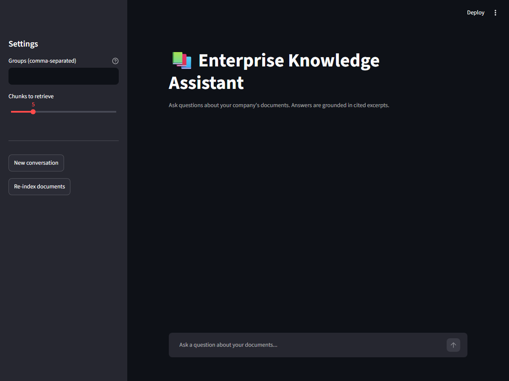

# Enterprise Knowledge Assistant (RAG)

> Ask questions about your company's PDF documents and get answers **with cited sources**.


Built by **[Rania Bentatou](https://github.com/rnnttou)**.

---



---

## What it does

1. **Upload PDFs** (policies, manuals, reports…)
2. **Split** them into small chunks of text
3. **Embed** each chunk with Google Gemini (free tier), turning text into vectors
4. **Store** the vectors in ChromaDB
5. **Answer questions**: find the most relevant chunks, then let Gemini write an answer that cites which document and page each fact came from

```
PDF ──► chunks ──► embeddings ──► ChromaDB
                                      │
question ──► hybrid search (BM25 + vectors) ──► top chunks ──► Gemini ──► answer + sources
```

## Tech stack

| Layer            | Tool                          |
|------------------|-------------------------------|
| LLM + embeddings | Google Gemini API (free tier) |
| Vector store     | ChromaDB                      |
| Keyword search   | BM25 (`rank-bm25`)            |
| API              | FastAPI                       |
| UI               | Streamlit                     |
| Packaging        | Docker / docker compose       |
| Tests            | pytest                        |

## Roadmap

- [x] **Step 1**: project skeleton and configuration
- [x] **Step 2**: load PDFs and split them into chunks
- [x] **Step 3**: embeddings with Gemini, stored in ChromaDB
- [x] **Step 4**: question answering with cited sources
- [x] **Step 5**: FastAPI backend
- [x] **Step 6**: Streamlit UI
- [x] **Step 7**: hybrid retrieval (BM25 + vector search)
- [x] **Step 8**: conversation memory
- [x] **Step 9**: Docker packaging
- [x] **Step 10**: evaluation on 30–50 test questions (retrieval hit rate + latency)

## Getting started

### 1. Clone and create a virtual environment

```bash
git clone https://github.com/rnnttou/enterprise-knowledge-assistant.git
cd enterprise-knowledge-assistant
python -m venv .venv
# Windows
.venv\Scripts\activate
# macOS / Linux
source .venv/bin/activate
pip install -r requirements.txt
```

### 2. Add your Gemini API key

Get a free key at <https://aistudio.google.com/apikey>, then:

```bash
cp .env.example .env      # Windows: copy .env.example .env
```

Open `.env` and paste your key after `GEMINI_API_KEY=`.

### 3. Check the setup

```bash
python -m app.config
```

### 4. Index your PDFs

`data/` isn't committed, so bring your own PDFs, or use the same sample set
this README's numbers were measured on:

- Colorado College Employee Policy Handbook
- NIST Cybersecurity Framework 2.0 (NIST CSWP 29)
- ANRT quarterly telecom market memo, Q2 2023
- ANRT annual report, 2018-2019

<!-- TODO: add direct download links for the four files above -->

Then embed them into ChromaDB (stored in `chroma_db/`):

```bash
python -m app.vector_store
```

Re-running is cheap: unchanged files are skipped, changed files have their chunks replaced, and deleted files are removed from the index. The free Gemini tier is rate-limited, so the first run pauses and retries when it hits the limit.

PDFs in a sub-folder are only visible to that group: `data/hr/salaries.pdf` can be read by `hr`, while files directly in `data/` are public.

**This is a demonstration of group-based filtering, not real access control.** The caller states which groups they belong to (via `--groups`, the API's `groups` field, or the Streamlit sidebar) and the system trusts that claim -- there's no authentication, so anyone can type `hr` and read HR-only documents. In production, `groups` would come from the authenticated user's token (e.g. claims in a verified JWT or a lookup against an identity provider), never from a client-supplied field.

Try a search:

```bash
python -m app.vector_store --query "How many vacation days do employees get?"
python -m app.vector_store --query "salary bands" --groups hr
```

### 5. Ask a question

```bash
python -m app.qa "How many vacation days do employees get?"
python -m app.qa "salary bands" --groups hr
```

The chat model only sees the retrieved excerpts (never the full corpus), answers from them alone, and cites which excerpt each fact came from. Answers print alongside the source document and page for each excerpt used.

### 6. Run the API

```bash
uvicorn app.api:app --reload
```

Then open <http://127.0.0.1:8000/docs> for interactive API docs, or call it directly:

```bash
curl http://127.0.0.1:8000/health
curl -X POST http://127.0.0.1:8000/ask -H "Content-Type: application/json" \
  -d '{"question": "How many vacation days do employees get?", "groups": ["hr"], "k": 5}'
curl -X POST http://127.0.0.1:8000/index
```

`/ask` runs the same retrieval + citation pipeline as `python -m app.qa` and returns
`{"answer": ..., "citations": [{"marker", "source", "page", "snippet"}], "refused": ..., "conversation_id": ...}`.
`refused` is `true` when the documents don't contain the answer. `/index` re-runs the indexer, so new PDFs dropped into `data/` can be picked up without a server restart.

Pass the `conversation_id` from a response back into your next request to ask a
follow-up ("What about for part-time staff?") that's understood in context of
the earlier question and answer (Step 8). Omit it to start a new conversation.
History is kept in memory per `conversation_id`, capped at the last 6 turns,
and is lost on restart.

### 7. Run the Streamlit UI

With the API running (step 6) in one terminal, start the UI in another:

```bash
streamlit run app/streamlit_app.py
```

Then open <http://localhost:8501>. It's a thin client over the API: pick your
groups and chunk count in the sidebar, ask questions in the chat box, and
expand "Sources" under an answer to see the cited pages and snippets. Point it
at a different backend with `API_URL=http://host:port streamlit run app/streamlit_app.py`.

### 8. Run the tests

```bash
pytest
```

The tests use a fake embedder, so they run offline and don't use your API quota.

### 9. Run everything with Docker

With `.env` set up (step 2) and PDFs in `data/` (step 4):

```bash
docker compose up --build
```

This builds one image and runs it as two containers: `api` (FastAPI on
<http://localhost:8088>, mapped from the container's port 8000 - see the
comment in `docker-compose.yml` if you hit a port-binding error on
Windows/WSL) and `ui` (Streamlit on <http://localhost:8501>, pointed at `api`
over the compose network). `data/` and `chroma_db/` are mounted as volumes, so
PDFs and the index persist across restarts. Index your documents with
`curl -X POST http://localhost:8088/index` or the UI's "Re-index documents"
button.

### 10. Evaluate retrieval quality

```bash
python -m app.evaluate
```

Runs `tests/eval_questions.json` (38 answerable questions plus 8 intentionally
unanswerable ones, over the sample PDFs in `data/`) through vector search,
BM25, and hybrid search side by side, reporting hit@1, hit@5, and MRR scored
at the page level, plus whether the refusal gate correctly rejects the
unanswerable questions. Only the query is embedded, so this doesn't spend
chat-model quota. Add `--full` to run the complete answer pipeline instead
and see real citations and refusals; see [Evaluation](#evaluation) for a
sample run.

## Project structure

```
enterprise-knowledge-assistant/
├── app/                # application code
│   ├── config.py       # settings loaded from .env
│   ├── chunking.py     # PDF loading and splitting (Step 2)
│   ├── embeddings.py   # Gemini embeddings (Step 3)
│   ├── vector_store.py # ChromaDB indexing and search (Step 3)
│   ├── qa.py           # question answering with cited sources (Step 4)
│   ├── api.py          # FastAPI backend (Step 5)
│   ├── streamlit_app.py # Streamlit UI (Step 6)
│   └── evaluate.py     # retrieval hit rate and latency (Step 10)
├── chroma_db/          # the vector index (created on first run, not committed)
├── data/               # put your PDFs here (not committed, see Sample data)
├── tests/              # unit tests and evaluation questions
├── Dockerfile           # image shared by the api and ui containers (Step 9)
├── docker-compose.yml   # runs api + ui together (Step 9)
├── .env.example        # template for secrets
├── requirements.txt
├── LICENSE
└── README.md
```

## Evaluation

`python -m app.evaluate` against the sample PDFs in `data/` (employee
handbook, NIST Cybersecurity Framework 2.0, two ANRT telecom market reports),
using the 38 answerable questions in `tests/eval_questions.json`. Each
question's ground truth is the exact source document **and page** that
answers it (found by locating the passage by hand, not guessed), so a hit
requires retrieving the right page, not just the right document -- a much
stricter bar than document-level hit rate, which "100% hit rate on 4 very
different documents" doesn't really test. A hit counts a page within ±1 of
the expected one, since chunking can split an answer across a page boundary.

```
method     hit@1   hit@5     mrr   avg latency
vector    78.9%  97.4%   0.854        472ms
bm25      73.7% 100.0%   0.841          4ms
hybrid    84.2%  97.4%   0.891        789ms
```

- **hit@1** -- is the expected page the single top result?
- **hit@5** -- does the expected page appear anywhere in the top 5?
- **MRR** -- mean reciprocal rank of the expected page (0 if never found)

This is what justifies hybrid retrieval rather than just asserting it:
hybrid's hit@1 and MRR beat both individual methods (vector alone misses
exact-term questions like acronyms and dates that BM25 catches; BM25 alone
misses paraphrases vector search catches), confirming the two signals are
complementary rather than one dominating. `vector` and `hybrid` call the
Gemini embedding API per question, so their latency includes a network round
trip and varies with free-tier rate limiting (observed 789ms-4.4s average
across runs); `bm25` doesn't call any API and stays in single-digit
milliseconds regardless.

**Refusal check**: the 8 questions in `tests/eval_questions.json` marked
`"unanswerable": true` (e.g. "What is the recipe for a classic French
bouillabaisse?") are outside all four documents. `python -m app.evaluate`
also reports how often the distance-based refusal gate (the same check
`app.qa.answer()` uses before spending a chat-model call) correctly refuses
these, and how often it wrongly refuses one of the 38 real questions instead:

```
Correctly refused: 100.0% (8 questions)
Wrongly refused answerable questions: 0.0% (38 questions)
```

Run `python -m app.evaluate --full` to go through the complete `answer()`
pipeline instead (spends Gemini chat-model quota, much slower), which
reports the same hit@1/hit@5/MRR from the actual citations returned, plus
real refusal counts from the chat model rather than the distance gate alone.

Re-run after changing chunking, retrieval, or `k` to see the effect; numbers
will vary with your own documents and questions.

**BM25 performance**: `bm25_search()` used to rebuild its index (tokenizing
every chunk in the collection) on every single question, which dominated
retrieval latency. It's now built once per collection and cached, invalidated
only when `/index` actually changes something. Before: hybrid search
averaged ~1.8s per question (p95 ~5s) on this dataset; after: BM25's own
share of that latency dropped to ~4ms per question (shown in the table
above), with the remaining hybrid latency now coming almost entirely from
the embedding API call.

## License

MIT
